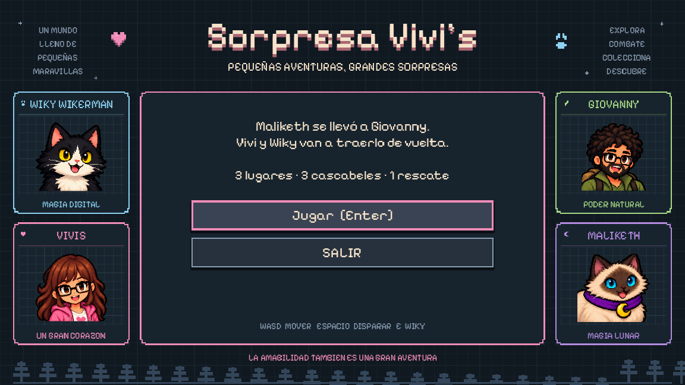
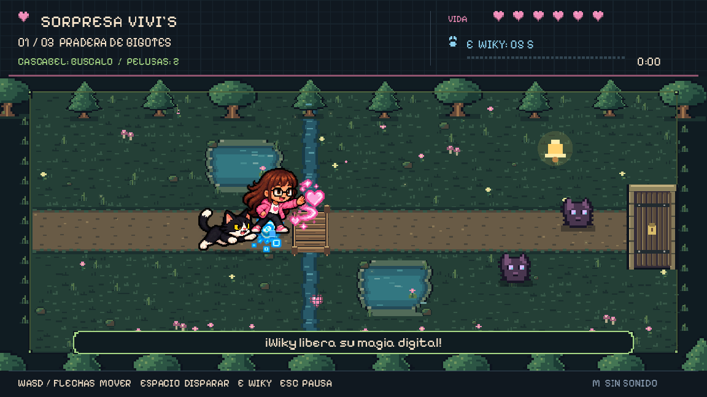

# Sorpresa Vivi’s

Juego **2D para PC**, corto y directo. Vivi y Wiky atraviesan la Pradera de Bigotes y el Sendero del Umbral, derrotan a Maliketh y rescatan a Giovanny.

## Jugar

**Windows 10/11, 64 bits:** descomprime `Sorpresa-Vivis-Windows.zip` y abre `Sorpresa-Vivis.exe`. No necesitas instalar Godot, Python ni conexión a Internet.

**Linux, 64 bits:** descomprime `Sorpresa-Vivis-Linux.zip` y ejecuta `./Sorpresa-Vivis.x86_64`. Si hace falta, usa `chmod +x Sorpresa-Vivis.x86_64`.

| Tecla | Acción |
| --- | --- |
| WASD o flechas | Mover a Vivi |
| Espacio, mantener pulsado | Disparar al enemigo más cercano |
| E o Enter | Magia digital de Wiky; cerca de Giovanny, rescatarlo |
| Esc | Pausar o continuar |
| R en derrota | Repetir el lugar actual |
| M | Activar/desactivar sonido |
| F11 | Pantalla completa |

Recoge el cascabel y elimina las pelusas de cada lugar para abrir la salida de la derecha. En la torre, recoge el último cascabel para romper el escudo de Maliketh. Cuando caiga, acércate a Giovanny y pulsa E.

Wiky te sigue y su ataque alcanza a los enemigos cercanos; recarga en 5 segundos. Los corazones recuperan vida. Al pasar de lugar recuperas toda la vida. Si pierdes puedes repetir ese lugar. La partida se pausa al cambiar de ventana. No hay guardado entre sesiones.

## Abrir el proyecto

Usa **Godot 4.6.3** e importa `godot_game/project.godot`. Pulsa F5 para jugar. Usa OpenGL de compatibilidad y no necesita plugins.

La versión jugable está en `godot_game/playable/`. `legacy_web/`, los módulos anteriores de Godot y `sorpresa-vivis-(4.2)/` quedan como referencia; la escena de inicio ahora es la aventura completa.

## Diseño visual

Los personajes siguen la referencia visual aportada para Sorpresa Vivis: Vivi lleva lentes, cabello castaño y sudadera rosa; Wiky es un gato blanco y negro de ojos amarillos; Giovanny lleva lentes, barba, ropa verde y mochila; Maliketh es una gata siamesa de ojos azules, pañuelo violeta y dije lunar.

Los atlas transparentes conservan el arte generado a partir de esa referencia, con reposo, dos pasos de movimiento, magia, daño, victoria y retratos. Sus regiones y pivotes se definen en `playable/pixel_characters.gd` para alinear las poses al suelo. Los escenarios tienen árboles, agua, ruinas y arquitectura lunar; los efectos usan corazones rosas, cubos azules y magia violeta. El menú presenta los cuatro personajes con sus colores y marcos pixelados. La tipografía Pixelify Sans se distribuye con su licencia OFL en `playable/assets/OFL.txt` y en los ZIP.





## Verificación y exportación

```bash
godot --headless --path godot_game --editor --import --quit
godot --headless --path godot_game --script res://tests/playthrough.gd
bash scripts/build_pc.sh
```

Instala las plantillas de exportación **4.6.3** desde Godot antes de compilar. El script crea ejecutables con los recursos integrados y ZIP para Windows y Linux en `dist/`. La prueba de integración comprueba movimiento, colisiones, pausa, daño, curación, transiciones, habilidad de Wiky, jefe, rescate y reintento; termina con código distinto de cero si falla.
