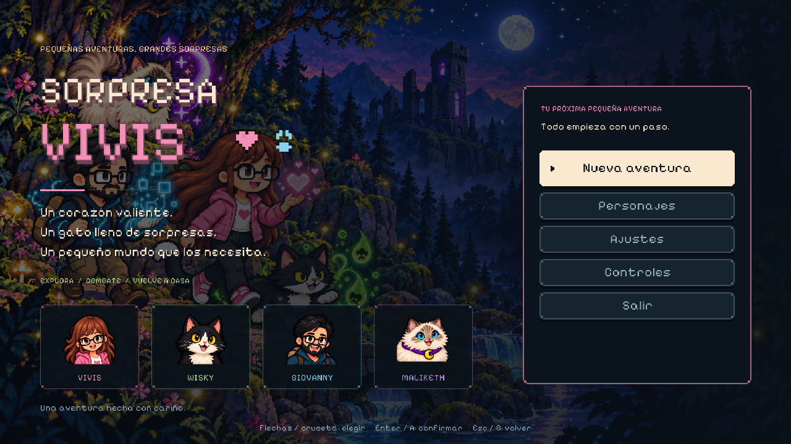
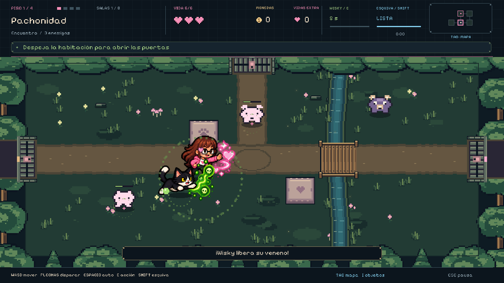
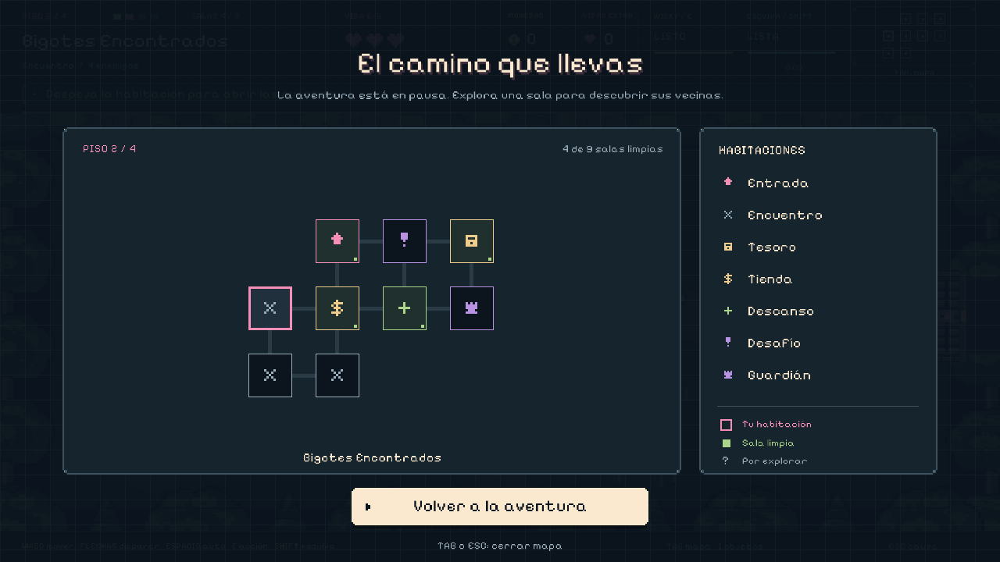

# Sorpresa Vivis

**Aventura roguelite 2D para PC · C++17 y raylib · versión 0.4.0.**

Vivi y Wisky recorren habitaciones conectadas para recuperar a sus amigos. Cada partida genera cuatro pisos distintos: **Pachonidad**, **Bigotes Encontrados**, **El alter ego de Wiky** y **Refugio de Maliketh**. Explora, esquiva, elige mejoras y baja al siguiente piso. La estructura se inspira en los juegos de mazmorras por habitaciones, con personajes, arte y música propios y un tono tierno.

## Jugar

**Windows 10/11 de 64 bits:** descomprime `Sorpresa-Vivis-Native-Windows.zip` y abre **Sorpresa-Vivis.exe**.

**Linux de 64 bits:** descomprime `Sorpresa-Vivis-Native-Linux.zip`, ejecuta `chmod +x Sorpresa-Vivis` si hace falta y abre `./Sorpresa-Vivis`. Requiere X11, OpenGL 3.3 y glibc 2.38 o posterior.

Todo el arte, tipografía y audio está integrado en el ejecutable. Funciona sin Internet y sin instalar un motor de videojuegos. Los menús aceptan teclado, ratón y mando. Ajustes incluye volumen, silencio, pantalla completa, movimiento reducido y modo tranquilo.

| Acción | Teclado y ratón | Mando |
| --- | --- | --- |
| Mover | WASD | Stick izquierdo / cruceta |
| Apuntar y disparar | Flechas, o mantener clic izquierdo | Stick derecho |
| Disparo al enemigo visible más cercano | Mantener Espacio | Mantener A / botón inferior |
| Veneno de Wisky / interactuar | E o Enter | X / botón izquierdo |
| Esquivar | Mayús o L | B / botón derecho |
| Mapa completo | TAB | Select / Back |
| Inventario y estadísticas | I | — |
| Elegir premio | Flechas y Enter, 1–3 o ratón | Cruceta y A |
| Pausa / volver / cerrar panel | Esc | Start |
| Nueva partida tras derrota | R o botón del menú | A |
| Pantalla completa / silencio | F11 / M | Ajustes |

## Habitaciones y recompensas

Cada piso contiene entre **8 y 11 habitaciones** conectadas, con distribución, encuentros, obstáculos y premios aleatorios. El minimapa muestra las salas descubiertas y las puertas pendientes; TAB abre el mapa con leyenda. Las puertas se sellan durante el combate y se abren cuando desaparecen los enemigos. Una sala despejada permanece despejada al volver.

- **Encuentros:** enemigos, monedas y posibles corazones.
- **Tesoro:** elige una de tres mejoras gratuitas en el pedestal central.
- **Tienda:** compra una de tres mejoras con las monedas de la partida.
- **Descanso:** recupera toda la vida y recibe un escudo para esa sala.
- **Desafío:** combate más exigente, más monedas y un objeto garantizado.
- **Guardián:** cálmalo, recoge tu mejora y usa la escalera para bajar. Recuperas un punto de vida al cambiar de piso.

Hay **14 objetos**, incluidos daño, velocidad, cadencia, disparo múltiple, más vida máxima, curación, vidas extra, escudos y suerte. Wisky tiene mejoras de veneno, frecuencia de ataque, alcance, recarga y nube ponzoñosa. El **Chip de Giovanny** invoca una proyección digital que ayuda a disparar. I permite consultar los objetos y las estadísticas actuales.

Wisky ataca automáticamente con **veneno verde**. Su acción E envenena a los enemigos cercanos; la nube deja daño persistente si tienes ese objeto. La esquiva protege brevemente y recarga en 1.6 segundos. Puedes moverte y disparar en direcciones independientes, o usar Espacio para apuntado automático.

Los ocho tipos de enemigos tienen comportamientos distintos: persecución, saltos, disparos, embestidas, órbitas, esporas y ecos. Los cuatro guardianes combinan ataques y cambian de patrón al perder vida. Las señales en el suelo anuncian saltos, cargas y zonas peligrosas antes de activarse.

## Amigos y final

**Vivi** lleva lentes, cabello castaño y sudadera rosa, y dispara corazones. **Wisky** es el gato blanco y negro de ojos amarillos, ponzoñoso. **Giovanny** tiene piel clara, pelo negro lacio, barba y lentes; su poder es digital, de color cian. **Maliketh** es una siamesa tabby point muy clara y pachona, de ojos azules, pañuelo violeta y luna dorada.

En el tercer piso, **Wiky Wikerman, el asesino de wiskys**, toma el control de Wisky. Vencer al alter ego lo recupera como compañero y fortalece su veneno. En el último piso, Maliketh deja un **churu garantizado** al rendirse. Recógelo y ofréceselo con E: se vuelve tu amiga, abre la jaula y puedes acercarte a Giovanny para rescatarlo.

Cada piso tiene música original propia, con un arreglo más intenso para su jefe. El churu cambia la música de Maliketh a una resolución cálida. La galería incluye retratos y poses de reposo, movimiento, magia, daño y victoria.







## Guardado

**Continuar** restaura la partida completa: semilla, piso, habitación, mapa, enemigos, vida, monedas, objetos y mejoras. Se guarda al viajar, limpiar salas, recoger premios y al cerrar el juego. Hay copia de respaldo del perfil anterior.

Una vida extra te revive con toda la vida y conserva tus objetos. Si pierdes sin vidas extra, esa partida termina: **Reintentar** comienza una nueva aventura aleatoria. Los ajustes se conservan. Los perfiles de la antigua versión lineal migran sus preferencias; sus checkpoints no representan el nuevo mapa.

Windows: `%LOCALAPPDATA%/SorpresaVivis/profile.txt`. Linux: `$XDG_DATA_HOME/sorpresa-vivis/profile.txt` o `~/.local/share/sorpresa-vivis/profile.txt`.

## Compilar y verificar

La versión principal está en **`native_game/`**. Godot y el prototipo web se conservan como referencias anteriores. Los atlas y la fuente se toman de `godot_game/playable/assets/` al compilar.

En Linux x86-64, con Python 3.9+, g++, `dpkg-deb` y bibliotecas de escritorio X11/OpenGL:

```bash
python3 scripts/build_native.py --bootstrap --platform all --test
```

El helper descarga raylib 5.5 y, si falta, MinGW portable. Versiones y SHA256 están fijados; no instala paquetes del sistema. Después se puede compilar sin red:

```bash
python3 scripts/build_native.py --platform all --test
```

Binarios: `build/native/{windows,linux}/`. Paquetes con instrucciones y licencias: `dist/`. También se puede usar `--platform windows` o `--platform linux`. El bootstrap de MinGW necesita un host compatible con Debian 13; [THIRD_PARTY.md](native_game/THIRD_PARTY.md) documenta dependencias y overrides.

Las pruebas del modelo cubren generación conectada y reproducible, viajes, recompensas, veneno, colisiones, vida extra, recuperación de Wisky, churu, rescate y persistencia. El programa ofrece comprobaciones gráficas sin modificar el perfil personal:

```bash
build/native/linux/Sorpresa-Vivis --smoke-test
build/native/linux/Sorpresa-Vivis --capture /tmp/vivis-preview
```

Validación de esta versión: **55 escenarios** del modelo pasan, también con ASAN, UBSAN e iteradores de depuración; **400 mapas** conectados y **100 finales** con churu garantizado. La auditoría de accesibilidad y guardado cubrió **3,800 habitaciones**. La prueba real de teclado y ratón pasó **46 comprobaciones**, incluidas cinco reaperturas y conservación exacta del perfil. Windows se comprobó con Wine 10.

El segundo comando captura veinte escenas y termina automáticamente. La entrada de mando está implementada; la validación en este entorno no incluye un mando físico.

Código: `game.cpp` (mapas, progresión y objetos), `combat.cpp` (enemigos, veneno y proyectiles), `audio.cpp` (música y efectos), `profile.cpp` (guardado), `main.cpp` (ventana y entrada), `characters.cpp` (actores y efectos), `world.cpp` (salas) e `interface.cpp` (menús, mapa y HUD).

Pixelify Sans incluye licencia OFL. Raylib y su licencia acompañan cada ZIP. Arte generado y música original del proyecto.
